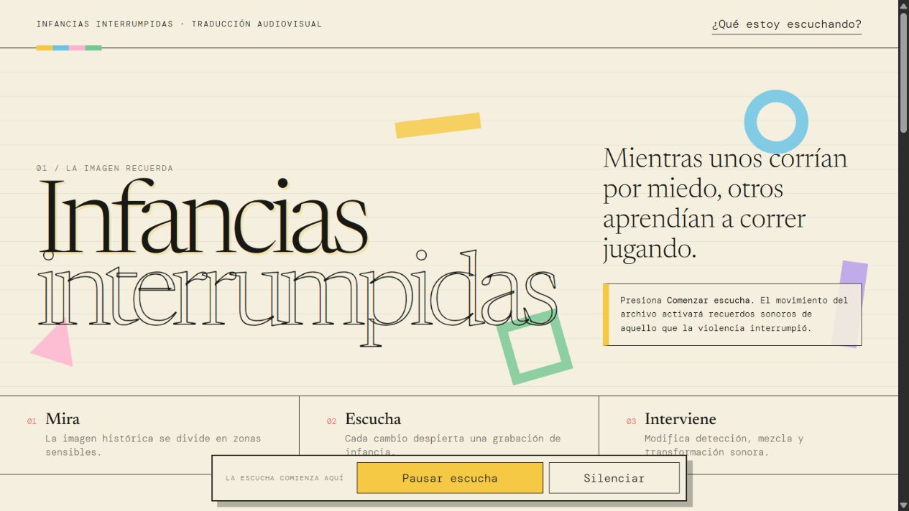
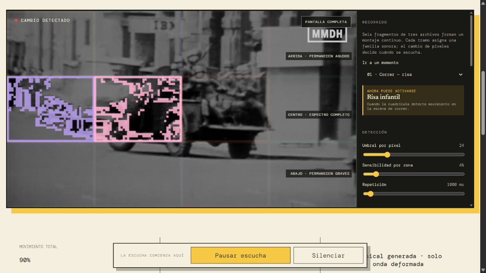
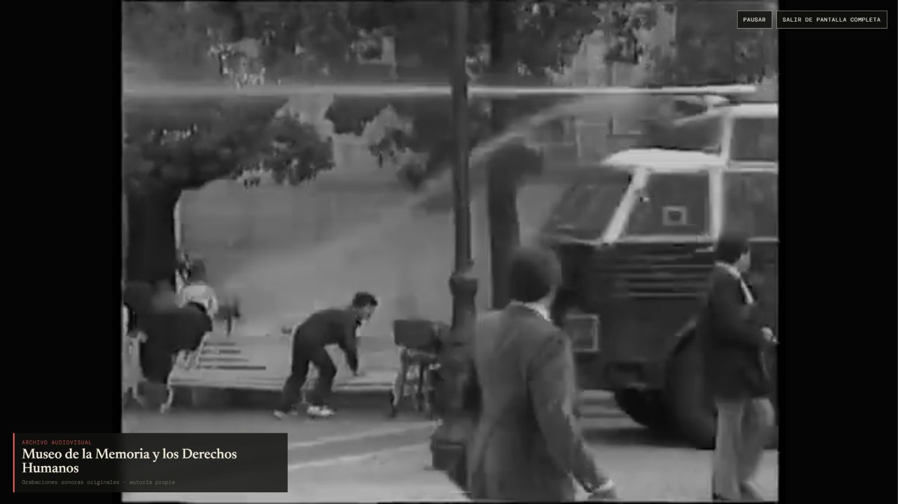

# Infancias interrumpidas

Plataforma audiovisual interactiva que traduce escenas históricas de represión en sonidos asociados a la infancia, la respiración y la búsqueda de una figura cercana.

> Mientras unos corrían por miedo, otros aprendían a correr jugando.

## 1. Concepto y relación imagen–sonido

**Infancias interrumpidas** propone una relación de contraste. En lugar de repetir literalmente disparos, gritos o vehículos militares, hace audible aquello que la violencia interrumpe: el juego, la seguridad, la respiración tranquila y la cercanía familiar.

El recorrido combina seis fragmentos breves de archivos históricos del Museo de la Memoria y los Derechos Humanos. Cada fragmento establece un contexto sonoro y la detección de cambio decide cuándo aparece cada sonido. La máquina no reconoce armas, humo ni personas: compara la luminosidad de los píxeles entre fotogramas. Interpretar ese cambio como risa, caja musical, respiración o voz es una decisión de diseño.

## 2. Banco de sonidos y disparador

La plataforma utiliza siete sonidos. Las voces, risas y respiraciones fueron grabadas por la autora. Su sobrina de 4 años participa en las voces y la risa; su sobrino de 12 años interpreta las respiraciones. Se cuenta con autorización familiar y no se publican los nombres de los menores. La caja musical se genera en tiempo real mediante síntesis Web Audio, por lo que no depende de un archivo externo.

| Sonido | Contenido | Autoría / interpretación | Licencia o permiso |
|---|---|---|---|
| `risas-nina.ogg` | Risa infantil | Grabación propia; sobrina de 4 años | Autoría propia y uso familiar autorizado |
| Caja musical Web Audio | Secuencia de ocho notas sintetizadas | Diseño y programación propia | Autoría propia |
| `respiracion-agitada-01.ogg` | Respiración | Grabación propia; sobrino de 12 años | Autoría propia y uso familiar autorizado |
| `respiracion-agitada-02.ogg` | Respiración | Grabación propia; sobrino de 12 años | Autoría propia y uso familiar autorizado |
| `respiracion-agitada-03.ogg` | Respiración | Grabación propia; sobrino de 12 años | Autoría propia y uso familiar autorizado |
| `mama.ogg` | Voz: “mamá” | Grabación propia; sobrina de 4 años | Autoría propia y uso familiar autorizado |
| `mama-donde-estas.ogg` | Voz: “mamá, ¿dónde estás?” | Grabación propia; sobrina de 4 años | Autoría propia y uso familiar autorizado |

### Disparador y mapping

El video se reduce para el análisis y se divide en una cuadrícula de 4 × 3. Cada zona compara la luminosidad del fotograma actual con el anterior. Cuando la proporción de píxeles modificados supera la sensibilidad y ya pasó el tiempo de repetición, la zona puede activar un sonido.

| Momento | Dato visual | Respuesta sonora |
|---|---|---|
| 01 · Correr | Movimiento dentro del fragmento | Risa infantil |
| 02 · Interrupción | Inicio y movimiento del fragmento | Caja musical generada |
| 03 · Respirar | Movimiento del agua, personas y humo | Una de tres respiraciones agitadas |
| 04 · Rostro | Presencia y cambio visual | “Mamá” |
| 04 · Ausencia | Cambio del último fragmento | “Mamá, ¿dónde estás?” |

El sistema mezcla como máximo las dos zonas con mayor cambio. La posición horizontal controla el paneo; la posición vertical filtra el espectro; y la intensidad puede modificar volumen y deformación. Cada tramo presenta suavemente su familia sonora al comenzar. Si la imagen queda quieta durante varios segundos, realiza una activación tenue para mantener la continuidad sin convertir el banco en música de fondo.

La persona puede desactivar archivos individuales. El botón **Probar** reproduce cada fuente sin transformaciones para compararla con el resultado del mapping.

## 3. Parámetros y gráfica

### Parámetros

- **Umbral por píxel:** define cuánto debe cambiar la luminosidad para registrar movimiento.
- **Sensibilidad por zona:** define qué proporción de la zona debe cambiar para activar sonido.
- **Repetición:** evita activaciones continuas de una misma zona.
- **Volumen general y por familia:** adapta la mezcla sin modificar las grabaciones originales.
- **Intensidad → volumen:** un cambio mayor puede producir una aparición más fuerte.
- **Posición horizontal → pan:** traslada el sonido entre izquierda y derecha.
- **Posición vertical → espectro:** arriba conserva agudos, el centro mantiene el espectro y abajo conserva graves.
- **Tramo → ADSR:** la risa es breve, la caja se corta con rapidez, la respiración crece lentamente y las voces dejan una salida más larga.
- **Intensidad → deformación:** altera progresivamente la onda cuando aumenta el cambio visual.

### Gráfica

La interfaz utiliza superficies crema y oscuras con una composición de inspiración editorial. La portada clara presenta el concepto; el video conserva su fondo oscuro y el panel lateral organiza los controles; la partitura y la reflexión priorizan la legibilidad. Los colores de la detección aparecen únicamente como señales: verde menta para las risas, rosa pastel para la caja musical, celeste para las respiraciones y violeta para las voces.

La portada utiliza una tipografía sans serif de alto peso visual, combinada con texto monoespaciado para instrucciones y controles. La paleta pastel se reserva para distinguir las cuatro familias sonoras, sobre superficies crema y oscuras que dan contraste y legibilidad. Los círculos concéntricos sugieren la propagación de la memoria y el sonido; se mantienen discretos para no competir con el contenido.

La tipografía combina titulares sans serif y una monoespaciada técnica. La experiencia muestra el video junto a un panel lateral de controles. La partitura registra los últimos diez segundos. En **Pantalla completa** desaparecen la cuadrícula, sus números y el panel técnico; permanecen el archivo, las huellas activadas, los controles esenciales y la atribución al Museo.

### Capturas del proceso







## 4. Reflexión

La traducción evidencia que una máquina no comprende la violencia de una escena. Solo registra diferencias de luminosidad, posición y cantidad de cambio. El significado aparece cuando diseñamos una relación entre esos datos y un banco de sonidos. El contraste permite escuchar la pérdida de seguridad sin repetir literalmente los sonidos de la violencia.

El sistema deja fuera el contexto histórico, la identidad de las personas y la diferencia entre correr jugando y correr por miedo. Ambos movimientos pueden producir datos parecidos aunque su significado sea completamente distinto. Esa limitación forma parte de la reflexión sobre cómo una herramienta técnica recorta la realidad.

Una mejora futura sería incorporar un pincel para dibujar zonas irregulares y seleccionar qué partes de la imagen participan, en lugar de depender únicamente de rectángulos. Otra mejora sería permitir modificar directamente con el mouse el largo y la amplitud de la envolvente o de las ondas. También sería útil incluir una línea de edición visual para ajustar cortes y mappings sin modificar el código.

## Créditos

- **Material audiovisual:** Museo de la Memoria y los Derechos Humanos. Uso académico con atribución visible dentro de la plataforma.
- **Grabaciones sonoras:** autoría propia, registradas especialmente para el proyecto.
- **Caja musical:** síntesis generada en el navegador mediante Web Audio API, de autoría propia.

## Uso y publicación

La plataforma está preparada para GitHub Pages. En **Settings → Pages**, seleccionar **Deploy from a branch**, rama `main`, carpeta `/ (root)` y guardar. El `index.html` de raíz redirige a `web/`.

Para probar localmente:

```powershell
py -m http.server 8064
```

Luego abrir `http://127.0.0.1:8064` y presionar **Comenzar escucha** para habilitar Web Audio.

## Entregables

- Plataforma web funcional y adaptable.
- README organizado en las cuatro partes solicitadas.
- Banco de siete sonidos con autoría y permisos identificados.
- Tres capturas del proceso.
- Créditos audiovisuales y sonoros visibles.
- Pendiente de entregar: enlaces definitivos al repositorio y GitHub Pages, además de un video demostrativo de 30 a 60 segundos.


### Archivos de video optimizados

Para la publicación se exportaron únicamente los seis fragmentos empleados en el recorrido, sin audio original y con compresión H.264. Los archivos largos se conservan fuera del repositorio publicable. Cada fragmento inicia en el segundo 0 y sus duraciones corresponden a las reglas del montaje.
